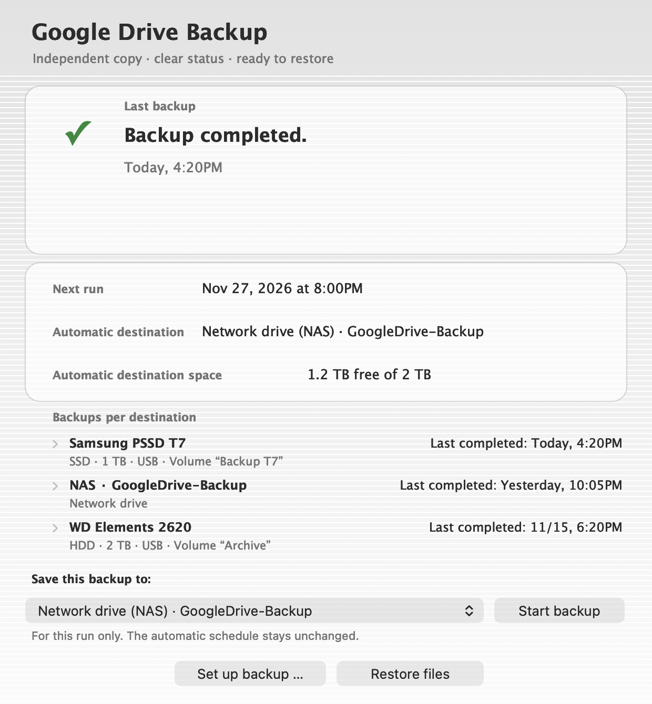
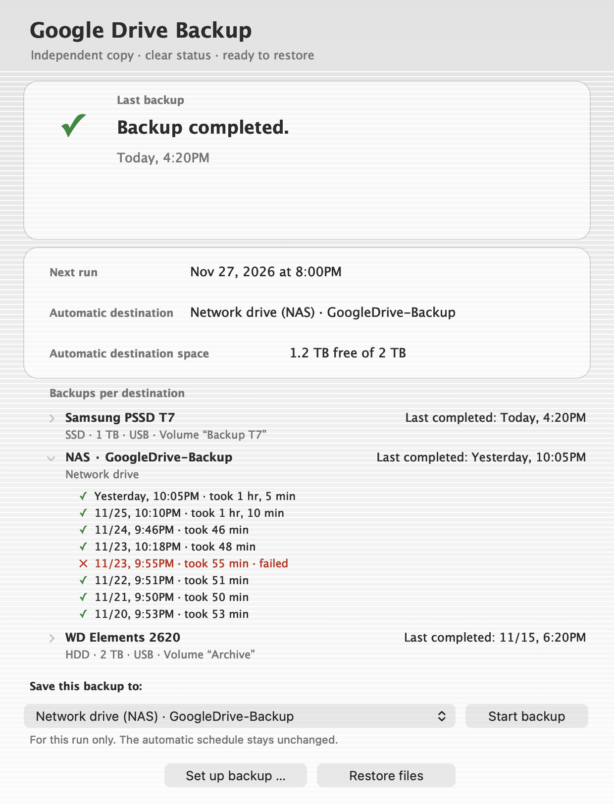

# GDrive Backup Tiger

[](https://github.com/AlexanderSmyslowski/gdrive-tiger-backup/actions/workflows/ci.yml)

**Google Drive syncs your files. This app backs them up.**

A free, open-source Mac app that keeps an independent copy of your Google
Drive on an external disk or a NAS, on a schedule, with earlier versions kept
and a clear status. No Terminal needed.

<p align="center">
  
</p>

## Why

- **Sync is not a backup.** Google Drive for desktop mirrors every change.
  Delete a folder by mistake, or let ransomware encrypt your files, and the
  damage reaches Google Drive too. A backup is a separate copy that such
  changes cannot touch.
- **Your copy, at home.** The backup lands on a disk or NAS you own, readable
  without this app (Google Docs, Sheets and Slides are exported to Office
  formats).
- **It tells you the truth.** You see when each destination last completed a
  backup, and a failed run is reported instead of hidden.

## What you get

- Backups to an external disk (APFS) or a NAS (SMB), on a daily schedule, at
  login or by hand; missed runs are caught up.
- Earlier versions of changed and deleted files are kept, and you restore them
  from the app, with a check that the restored file is intact.
- The overview shows, per NAS and per drive (named by device, e.g. "Samsung
  PSSD T7 · SSD · 1 TB"), the last completed backup and the recent runs.
- Read-only access to Google Drive: the app never changes or deletes anything
  there.
- Safeguards for unattended runs: the backup stops cleanly when a NAS
  disappears or a copy stalls, and never writes to the wrong disk.
- Optional end-to-end encryption with `rclone crypt`.
- Updates install from the app after checking their checksum.
- English, German, French, Spanish, Japanese, Cantonese and Korean.

<p align="center">
  
</p>

## Quick start

1. **Install the app.** Download the `.pkg` installer from the
   [latest release](https://github.com/AlexanderSmyslowski/gdrive-tiger-backup/releases/latest)
   and double-click it. Because the package is not signed by Apple yet, macOS
   first says it cannot verify it: click **Done** (not *Move to Trash*), open
   **System Settings › Privacy & Security**, click **Open Anyway** next to the
   package, and confirm.
2. **Set up in the app.** Open *GDrive Backup Tiger*, click **Set up backup …**,
   click **Connect Google**, choose an external disk or your NAS and a
   schedule, then **Save**. Connecting walks you once through creating your own
   free Google access client (about 3 minutes in the Google Cloud console; the
   app opens each page and picks up the downloaded file itself), then your
   browser asks for read access. This is needed because Google is retiring the
   shared client built into rclone.

The installer includes `rclone` and `jq`, so Homebrew is not required. If
Homebrew versions are installed, the app and the engine prefer them and keep
their updates.

### Schnellstart (Deutsch)

1. **App installieren:** Das `.pkg`-Installationspaket von der
   [aktuellen Release-Seite](https://github.com/AlexanderSmyslowski/gdrive-tiger-backup/releases/latest)
   laden und doppelklicken. Meldet macOS, das Paket könne nicht überprüft
   werden: **Fertig** wählen (nicht *In den Papierkorb*), **Systemeinstellungen
   › Datenschutz & Sicherheit** öffnen, bei dem Paket **Dennoch öffnen** klicken
   und bestätigen.
2. **In der App einrichten:** *GDrive Backup Tiger* öffnen, **Backup einrichten …**
   wählen, **Mit Google verbinden** klicken, externe Festplatte oder NAS und
   Zeitplan wählen, **Speichern**. Beim Verbinden führt die App einmalig durch
   das Anlegen einer eigenen, kostenlosen Google-Zugangskennung (etwa 3 Minuten
   in der Google-Cloud-Konsole; die App öffnet jede Seite und übernimmt die
   heruntergeladene Datei selbst), danach fragt der Browser nach Lesezugriff.
   Nötig ist das, weil Google die in rclone eingebaute gemeinsame Kennung
   abschaltet.

`rclone` und `jq` sind im Installationspaket enthalten, Homebrew ist nicht nötig.
Sind Homebrew-Versionen installiert, nutzen App und Backup-Routine diese und
behalten so deren Updates.

Current release: `v2.10.0` with your own Google connection set up from the app (an assistant for the Google Cloud console, because Google is retiring rclone's shared client), updates installed from the app (daily check, verified download, macOS administrator prompt), a history of completed backups per destination (named drives, SSD/HDD, expandable runs), setup that needs no Terminal (Google sign-in from the app, rclone and jq included in the installer), plain-language status and setup texts, automatic catch-up of missed daily backups, NAS mounting without a Keychain grant after each update, a watchdog that stops a copy when the NAS disappears, early detection of missing macOS privacy access, no more Trash or destination clutter, one-run destination selection in the main window, automatic NAS retries that wait for another backup to finish, a fail-closed APFS volume-creation contract, macOS-15-compatible physical-disk identity in external-backup confirmations, visible aggregate check activity when a byte total is unavailable, quiet recovery confirmations and opt-in routine success notifications, a truthful running state for automatic retries, private current-phase progress in the overview and menu bar, silent authenticated and guest SMB mounting, one current persistent automatic-failure alert, a safe retry for transient NAS read failures, passive handling of unknown external disks, verified APFS and NAS identity, one coherent Dock presence, optional end-to-end `rclone crypt` backups, retained versions, verified recovery, named profiles, diagnostics, and a persistent menu bar overview.

The release installer is `GDrive-Backup-Tiger-2.10.0.pkg`, accompanied by `SHA256SUMS.txt` on the [release page](https://github.com/AlexanderSmyslowski/gdrive-tiger-backup/releases/tag/v2.10.0). It is unsigned; see the Gatekeeper instructions below. Fresh-account installation and dry-run tests on macOS 13 and the current macOS release have not yet been completed; CI checks deployment metadata and both binary architectures, not that runtime coverage.

## Requirements

- macOS 13 Ventura or later
- `rclone` and `jq`: included in the release installer (rclone and jq release
  binaries, pinned in `packaging/bundled-tools.conf` and checked against the
  upstream SHA-256 sums). Homebrew copies take precedence when installed.
- `flock` is optional; without it the engine takes the same run lock through
  macOS's `perl`.

For installs from source, install the tools with Homebrew:

```bash
/bin/bash -c "$(curl -fsSL https://raw.githubusercontent.com/Homebrew/install/HEAD/install.sh)"
brew install rclone flock jq
```

## Documentation

- [Technical reference](docs/reference.md): how it works, installing from
  source or for a NAS, profiles, retention, restore, diagnostics, updates,
  encryption, launchd and packaging
- [Encryption](docs/encryption.md) · [Version history](docs/version-history.md)
  · [Signing and release](docs/signing-and-release.md)
- [Linux edition (preview)](docs/linux.md): command, systemd timer,
  notifications and a Waybar module for Omarchy and other Linux setups
- [Plan for the public launch](docs/public-launch-plan.md) ·
  [Linux edition plan](docs/linux-omarchy-plan.md)

GDrive Backup Tiger builds on [rclone](https://rclone.org). "Tiger" refers to
the Mac OS X Tiger-inspired look; the app requires macOS 13 Ventura or later.

## License

MIT
